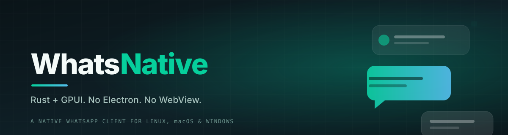
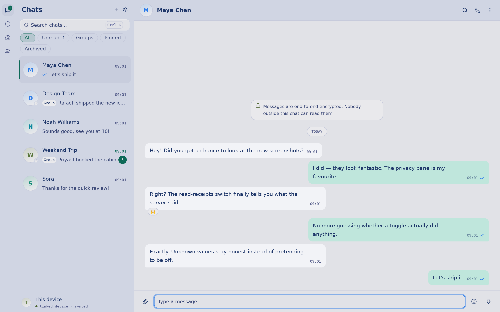
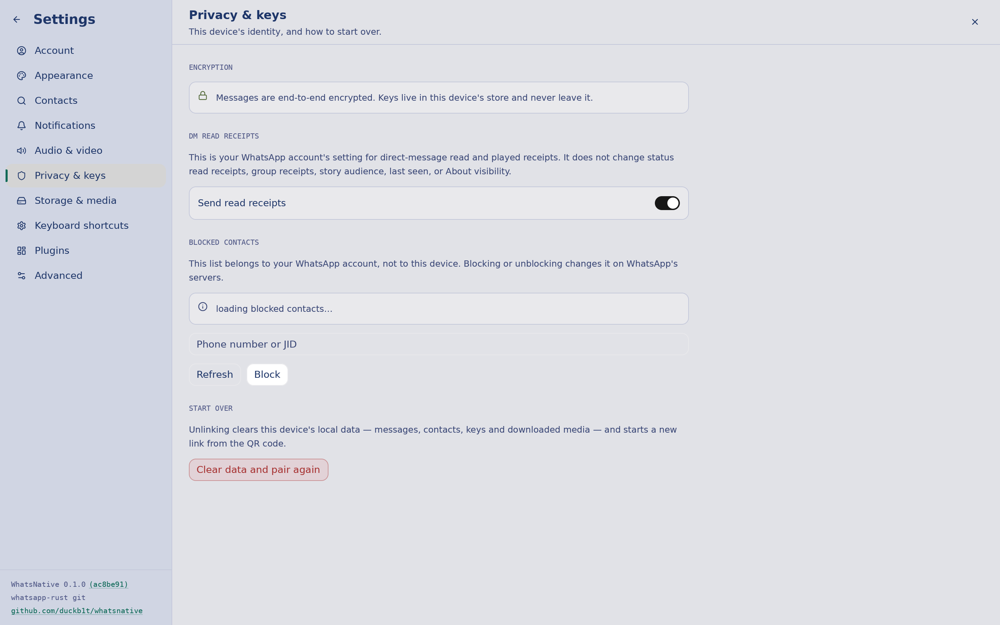
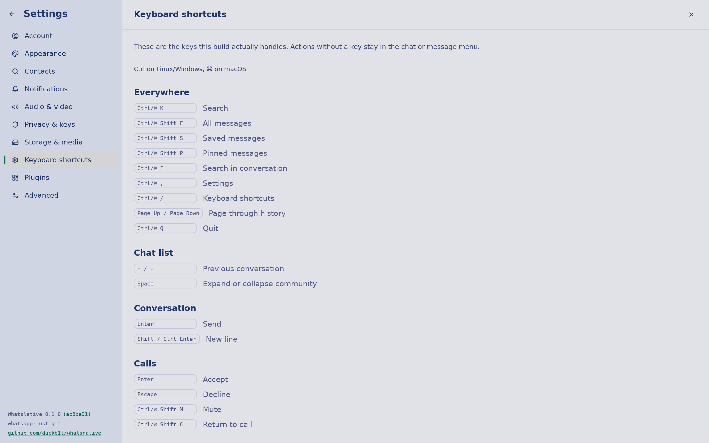
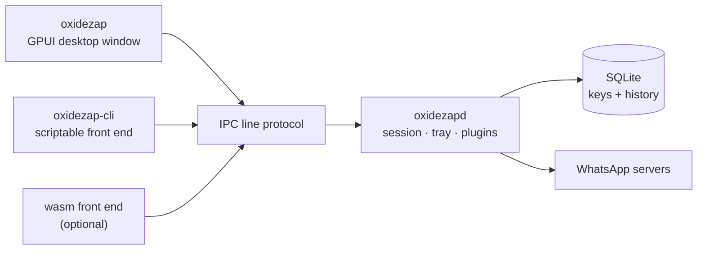

<div align="center">



<br><br>

<a href="https://github.com/DuckB1t/whatsnative/actions/workflows/ci.yml"></a>
<a href="https://github.com/DuckB1t/whatsnative/actions/workflows/build.yml"></a>


<a href="https://github.com/DuckB1t/whatsnative/stargazers"></a>

<br>

### WhatsApp, drawn by your GPU.

**A native client in Rust and [GPUI](https://github.com/zed-industries/zed).**
No Electron. No WebView. No website wearing a window costume.

**Not affiliated with, endorsed by, or connected to WhatsApp or Meta.**

</div>

---

## What it is

WhatsNative is a fork of [oxidezap/client](https://github.com/oxidezap/client).
The interface is rendered by the GPU from Rust code; the same tree also builds
a WebAssembly front end. Pairing, messaging, media and calls come from
[whatsapp-rust](https://github.com/oxidezap/whatsapp-rust).

Crate and binary names stay `oxidezap*` — that keeps the upstream dependency
graph and packaging intact. The product you see is WhatsNative.

| | WhatsNative |
| --- | --- |
| **Interface** | GPUI — GPU-drawn widgets, no browser engine |
| **Session** | One `oxidezapd` daemon owns the connection and store |
| **Front ends** | Desktop window, scriptable CLI, and a wasm build |
| **History** | Local SQLite with FTS5, migrated by the daemon |
| **Extensions** | Sandboxed `.wasm` plugins with per-capability approval |
| **Languages** | English and Portuguese UI |

## Screenshots

<details open>
<summary><b>Conversations</b> — the GPUI window with durable local history, reactions and read states.</summary>

<div align="center">
  
</div>

</details>

<details>
<summary><b>Privacy &amp; keys</b> — the account's DM read receipts, blocked contacts, and an honest start-over action.</summary>

<div align="center">
  
</div>

</details>

<details>
<summary><b>Keyboard shortcuts</b> — every key this build actually handles, in one place.</summary>

<div align="center">
  
</div>

</details>

<br>

> These are **real renders of the app**, produced by a headless GPUI test with
> invented names, JIDs and messages — no logged-in account is involved. To
> regenerate them:
>
> ```bash
> OXIDEZAP_SHOT_DIR="$(pwd)/docs/screenshots" cargo test -p oxidezap-gui --bin oxidezap \
>   -- --ignored previews --nocapture
> ```

## How it fits together



The daemon is the only part that holds a WhatsApp session. Windows hold no
session and no media cache; any number of them can attach to the same daemon.
Details in [docs/architecture.md](docs/architecture.md).

| Crate | Role |
| --- | --- |
| `oxidezap-core` | Domain types and the daemon's wire format |
| `oxidezap-chat-store` | SQLite history with FTS5 full-text search |
| `oxidezap-session` | Connection, event stream, sends, store hydration |
| `oxidezap-daemon` | `oxidezapd`: session, socket, tray, plugins |
| `oxidezap-ipc` | Protocol and transport shared by every front end |
| `oxidezap-gui` | `oxidezap`: GPUI window (also builds to wasm) |
| `oxidezap-cli` | `oxidezap-cli`: scriptable front end |
| `oxidezap-wire` | Lightweight DTOs for external scripts |
| `oxidezap-audio` / `oxidezap-video` | Capture, playback, codecs |
| `oxidezap-plugin-*` | wasm ABI, host and Rust SDK |

## Quick start

Rust 1.100.0 is pinned by `rust-toolchain.toml`. On Linux you also need ALSA,
X11/Wayland and fontconfig development headers:

```bash
sudo apt install libasound2-dev libxkbcommon-dev libxkbcommon-x11-dev \
  libwayland-dev libxcb1-dev libfontconfig1-dev libfreetype6-dev
```

```bash
cargo build --release --bin oxidezap --bin oxidezapd --bin oxidezap-cli
./target/release/oxidezap
```

The window starts the daemon beside itself, so keep the three binaries in the
same directory. The first build compiles the whole GPUI tree and takes a while.

Prebuilt archives and notes are on the
[releases page](https://github.com/DuckB1t/whatsnative/releases). Linux `.deb`,
`.rpm` and `.AppImage` packages are described in
[docs/linux-packaging.md](docs/linux-packaging.md).

## Documentation

| Guide | What it covers |
| --- | --- |
| [Our changes](docs/our-changes.md) | What this fork added, slice by slice, with the gates each passed |
| [Roadmap](docs/roadmap.md) | Known gaps and why they are not faked |
| [Architecture](docs/architecture.md) | Crate map, theme, and how responsiveness derives from one number |
| [Building](docs/building.md) | Web, plugin and profiling builds |
| [CLI](docs/cli.md) | The scriptable front end |
| [Localization](docs/localization.md) | English and Portuguese UI |
| [Web](docs/web.md) | The browser front end and what it cannot do |
| [Plugin ABI](docs/plugin-abi.md) | The contract for plugin authors |
| [Gotchas](docs/gotchas.md) | Non-obvious behaviour and the reasoning behind it |
| [AGENTS.md](AGENTS.md) | The decisions that hold the codebase together |

## Data and privacy

State lives in one SQLite file under the platform data directory
(`~/.local/share/oxidezap/whatsapp.db` on Linux): device identity, Signal state
and chat history together. Deleting it unlinks the device and discards local
history.

No account data, message content or paired identity is included in this
repository; every JID and phone number in the source, tests and screenshots is
a synthetic fixture. The optional web bridge is off by default and requires a
bearer token — read the [web notes](docs/web.md) before enabling it.

## Plugins

Plugins are `.wasm` modules installed under Settings → Plugins (or beside
`oxidezapd` on a desktop). There is no WASI: the `oxidezap` import module is a
plugin's entire outside world, so it cannot read the disk or open a socket.
Anything that touches the account — sending, marking read, typing — must be
approved separately and can be withdrawn. Start from `examples/template` or
read [docs/plugin-abi.md](docs/plugin-abi.md).

## Known limitations

- Group calls are implemented and draw a participant grid, but have not been
  live-validated; 1:1 calls have been.
- Several server-side or upstream-only features are deliberately not drawn:
  Meta AI/Private Processing, ads, channel subscriptions, business catalogs,
  passkeys, cross-platform chat transfer, story-audience mutation, arbitrary
  member tags, status read receipts, channel role administration, and more.
  They are listed in [docs/roadmap.md](docs/roadmap.md) rather than shipped as
  controls that do nothing.
- The privacy pane exposes one real account setting — direct-message read
  receipts. Other privacy categories stay documented gaps, not fake switches.
- A browser tab holding its own session shares one plugin agent; attaching to
  `oxidezapd` gives each plugin a thread.

## Credits

This fork stands on a lot of other people's work:

- [oxidezap/client](https://github.com/oxidezap/client) — the original native
  client this project forks (MIT, copyright João Lucas de Oliveira Lopes).
- [whatsapp-rust](https://github.com/oxidezap/whatsapp-rust) — protocol, Signal,
  media and VoIP implementation (MIT).
- [Zed's GPUI](https://github.com/zed-industries/zed) and
  [gpui-component](https://github.com/longbridge/gpui-component) — the UI
  toolkit and component library.
- [SQLite](https://www.sqlite.org/), [rusqlite](https://github.com/rusqlite/rusqlite),
  [diesel](https://diesel.rs/) and the Rust community crates in `Cargo.lock`.
- [Noto Color Emoji](https://github.com/googlefonts/noto-emoji) for the bundled
  emoji font.

The full dependency list, with versions and licenses, is in `Cargo.lock`.

## License

MIT. The upstream copyright notice is preserved in [LICENSE](LICENSE).
