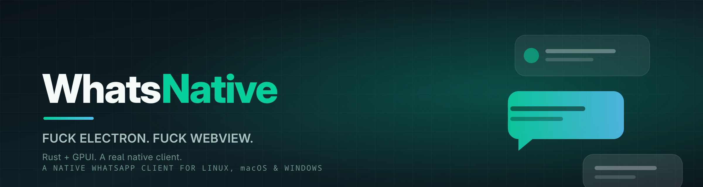
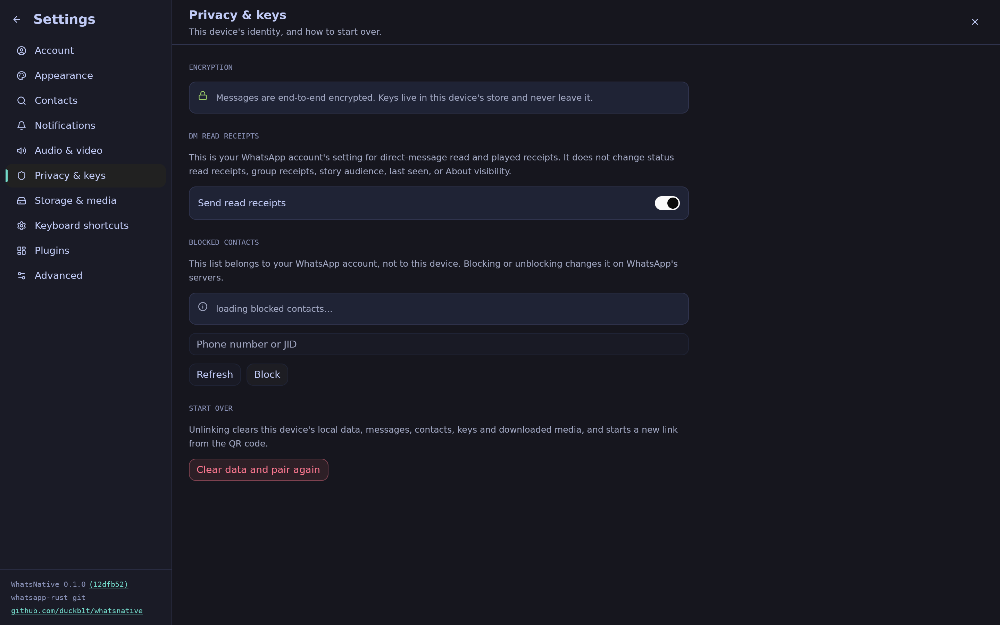
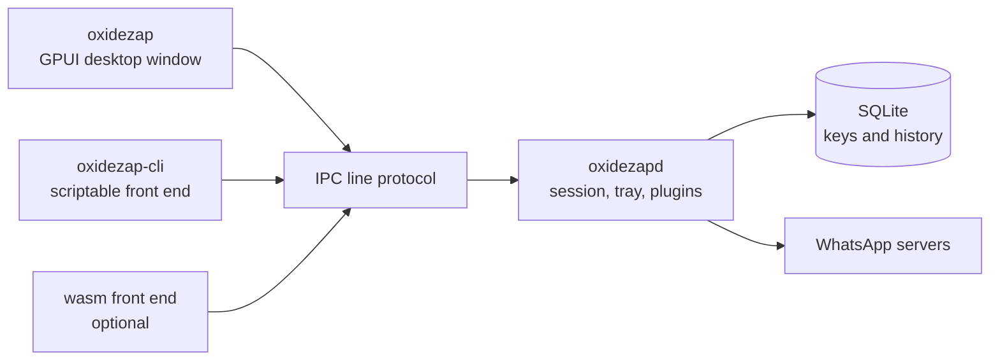

<div align="center">



<br><br>

# FUCK ELECTRON. FUCK WEBVIEW.

**WhatsNative is a WhatsApp client that actually runs on your desktop.**
Rust, GPUI, one daemon, zero browser engines hiding in the background.

<a href="https://github.com/DuckB1t/whatsnative/actions/workflows/ci.yml"></a>
<a href="https://github.com/DuckB1t/whatsnative/actions/workflows/build.yml"></a>


<a href="https://github.com/DuckB1t/whatsnative/stargazers"></a>

</div>

---

## No bullshit version

This is a native app. The interface is drawn by your GPU from Rust code. There
is no Chromium process, no DOM, no JavaScript framework, no 400 MB of browser
runtime so you can send "ok". One background daemon holds the session, the
keys and the history. Windows are dumb clients on top of it.

It is unofficial. It is not affiliated with WhatsApp or Meta. Do not expect us
to pretend otherwise.

It is also a fork of [oxidezap/client](https://github.com/oxidezap/client).
We kept the `oxidezap*` crate and binary names because renaming them would be
bullshit work with no payoff. The product is WhatsNative. The protocol, Signal,
media and call machinery come from
[whatsapp-rust](https://github.com/oxidezap/whatsapp-rust).

## Program status, blunt version

We did a deep audit of what a normal user notices and wrote it in
[docs/feature-plan.md](docs/feature-plan.md). The audit found no Calls tab, no
chat info panel, a disabled new chat button, a media jump list and a local-only
GIF/sticker picker with no search. All five of those gaps are closed locally now.
None of this is in v0.1.0.

Progress snapshot, not a live counter:

| Area | Progress |
| --- | --- |
| Investigation and plan | 100% |
| Wave 1, daily drivers | 100%, Calls, chat info, new chat, media gallery and local picker search done |
| Wave 2, message actions | 0% |
| Wave 3, privacy and settings | 0% |
| Wave 4, multi-account | 0% |
| MCP planning | 0% |
| Whole program | about 33%, 0% released |

Checklist:

- [x] Investigation and plan
- [x] Wave 1: Calls destination and call log view
- [x] Wave 1: chat info panel
- [x] Wave 1: new chat dialog
- [x] Wave 1: media gallery
- [x] Wave 1: local GIF and sticker search
- [ ] Wave 2: message actions with real APIs
- [ ] Wave 3: privacy and settings with real mutations
- [ ] Wave 4: multi-account V2
- [ ] MCP planning

Calls, chat info, new chat, the media gallery and local picker search are
implemented and green locally. None of it is in v0.1.0. The log shows only
finalized calls from this daemon start, capped at 100, and the pane says so on
screen. Chat info is a mirror of local state: name, raw JID, authoritative
roster, loaded-history media count and working mute and archive controls. It does
not invent About text, last seen, phone labels or a server-wide media total. The
gallery is bounded to the last 50 stored media rows. It shows the kind, filename,
dimensions and availability facts the stored proto actually carries, groups those
rows by chat and filters only what is already in hand. A thumbnail appears only
when this window already holds decodable bytes. No server-wide total,
downloaded-only claim or fake fetch sits behind those chips. The picker searches
only the tiles it already loaded: GIFs by chat, caption and file name, recent
stickers by the chat they came from. Favorites carry no text and are honestly not
searchable. Every surface says what it is on screen.

UI target: familiar layout, original design. No copied proprietary assets or
trade dress. The checklist gets updated after every wave.

## What actually works

| Thing | Status |
| --- | --- |
| Chats, groups, communities, channels, statuses | Working, with durable local history |
| Search | Everywhere, plus inside one conversation |
| Saved and starred messages | Working. Pinning capped at 30 days because that is what upstream allows |
| Media send and receive | Working. Local media gallery over stored history, no pretence of a cloud gallery |
| Voice and video calls | 1:1 validated. Group calls draw a grid but have not been live tested |
| Calls and chat details | Call log since daemon start, capped at 100. Details come from local state, not server profiles |
| Plugins | Sandboxed `.wasm`, per-capability approval, no filesystem, no sockets |
| Privacy | One real setting: DM read receipts. Everything else is honestly listed as missing |
| Languages | English and Portuguese |

## Screenshots

These are real renders of the app, not mockups. Every name, JID and message is
invented. No logged-in account was touched to make them.

<details open>
<summary><b>Conversations</b>, in the shipped dark theme.</summary>

<div align="center">
  
</div>

</details>

<details>
<summary><b>Privacy and keys</b>, including the one setting we can change honestly.</summary>

<div align="center">
  
</div>

</details>

<details>
<summary><b>Keyboard shortcuts</b>, every key this build really handles.</summary>

<div align="center">
  
</div>

</details>

<br>

To regenerate them:

```bash
OXIDEZAP_SHOT_DIR="$(pwd)/docs/screenshots" cargo test -p oxidezap-gui --bin oxidezap \
  -- --ignored previews --nocapture
```

## How it is put together



The daemon is the only thing that holds a WhatsApp session. A window holds no
session and no media cache. You can attach as many windows as you like. If that
sounds familiar, good, it is the right design. Read
[docs/architecture.md](docs/architecture.md) for the details.

| Crate | What it does |
| --- | --- |
| `oxidezap-core` | Domain types, also the wire format |
| `oxidezap-chat-store` | SQLite history with FTS5 |
| `oxidezap-session` | Connection, events, sends, hydration |
| `oxidezap-daemon` | `oxidezapd`: session, socket, tray, plugins |
| `oxidezap-ipc` | Protocol and transport |
| `oxidezap-gui` | `oxidezap`: the GPUI window, also builds to wasm |
| `oxidezap-cli` | Scriptable front end |
| `oxidezap-wire` | Small DTOs for scripts |
| `oxidezap-audio` / `oxidezap-video` | Capture, playback, codecs |
| `oxidezap-plugin-*` | wasm ABI, host and SDK |

## Build it

Rust 1.100.0 is pinned by `rust-toolchain.toml`. On Linux you also need ALSA,
X11/Wayland and fontconfig headers:

```bash
sudo apt install libasound2-dev libxkbcommon-dev libxkbcommon-x11-dev \
  libwayland-dev libxcb1-dev libfontconfig1-dev libfreetype6-dev
```

```bash
cargo build --release --bin oxidezap --bin oxidezapd --bin oxidezap-cli
./target/release/oxidezap
```

Keep the three binaries together. The window starts the daemon beside itself.
The first build compiles the whole GPUI tree, so go get a coffee.

Prebuilt AppImage and tarballs are on the
[releases page](https://github.com/DuckB1t/whatsnative/releases). Linux `.deb`
and `.rpm` packages are described in
[docs/linux-packaging.md](docs/linux-packaging.md).

## Docs, if you want the ugly details

| Guide | What is in it |
| --- | --- |
| [Our changes](docs/our-changes.md) | What we changed slice by slice, with the gates each passed |
| [Feature plan](docs/feature-plan.md) | Investigation, feasibility, waves and current progress |
| [Roadmap](docs/roadmap.md) | What is missing and why we refuse to fake it |
| [Architecture](docs/architecture.md) | Crate map, theme, one number that drives layout |
| [Building](docs/building.md) | Web, plugin and profiling builds |
| [CLI](docs/cli.md) | The scriptable front end |
| [Localization](docs/localization.md) | English and Portuguese |
| [Web](docs/web.md) | The browser build and its hard limits |
| [Plugin ABI](docs/plugin-abi.md) | The contract plugin authors must obey |
| [Gotchas](docs/gotchas.md) | Non-obvious behaviour and the reasoning behind it |
| [AGENTS.md](AGENTS.md) | The decisions that keep this thing from falling over |

## Data and privacy, without the marketing

Everything lives in one SQLite file under the platform data directory
(`~/.local/share/oxidezap/whatsapp.db` on Linux). Device identity, Signal state
and chat history are in that same file. Delete it and you unlink the device and
lose local history. That is the whole story.

There is no account data, no message content and no paired identity in this
repository. Every JID, phone number and message in tests and screenshots is a
fixture we invented. The web bridge is off by default and needs a bearer token.
Read [docs/web.md](docs/web.md) before you turn it on.

## Plugins

Plugins are `.wasm` modules installed under Settings → Plugins. There is no
WASI. The only thing outside the module is the `oxidezap` import module, so a
plugin cannot read your disk or open a socket. Sending, marking read and typing
each need separate approval, and you can take it back. Start from
`examples/template` or read [docs/plugin-abi.md](docs/plugin-abi.md).

## What we will not pretend to support

- Group calling is implemented and has a grid, but nobody has live tested it.
  1:1 calls have been tested.
- Meta AI, Private Processing, ads, channel subscriptions, business catalogs,
  passkeys, cross-platform chat transfer, story audience editing, arbitrary
  member tags, status read receipts and channel role admin are not here. Some
  are server owned, some have no public upstream API. We would rather say so
  than draw a switch that does nothing. The full list is in
  [docs/roadmap.md](docs/roadmap.md).
- The privacy pane has exactly one real account control: DM read receipts. The
  rest is a documented gap, not a lying toggle.
- A browser tab with its own session shares one plugin agent. Attaching to
  `oxidezapd` gives each plugin a thread.

## Credits, because we did not write all of this

- [oxidezap/client](https://github.com/oxidezap/client), the client we forked
  (MIT, copyright João Lucas de Oliveira Lopes).
- [whatsapp-rust](https://github.com/oxidezap/whatsapp-rust), which does the
  protocol, Signal, media and VoIP work (MIT).
- [Zed's GPUI](https://github.com/zed-industries/zed) and
  [gpui-component](https://github.com/longbridge/gpui-component), the UI kit.
- [SQLite](https://www.sqlite.org/), [rusqlite](https://github.com/rusqlite/rusqlite),
  [diesel](https://diesel.rs/) and everyone else in `Cargo.lock`.
- [Noto Color Emoji](https://github.com/googlefonts/noto-emoji) for the font.

## License

MIT. The upstream copyright notice is still in [LICENSE](LICENSE). We are not
stealing anybody's work and pretending it is ours.
